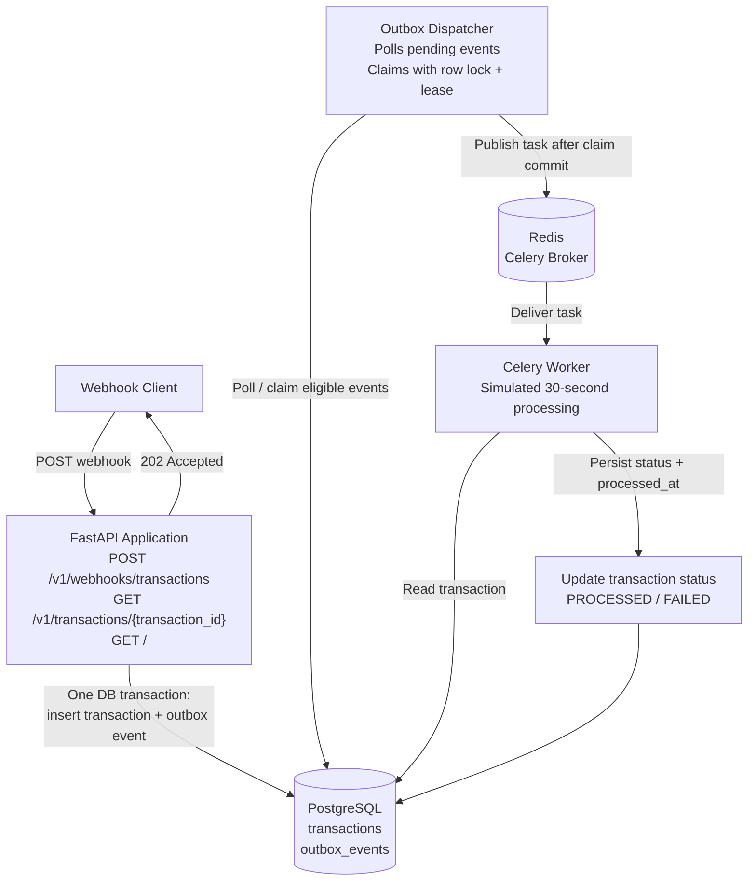
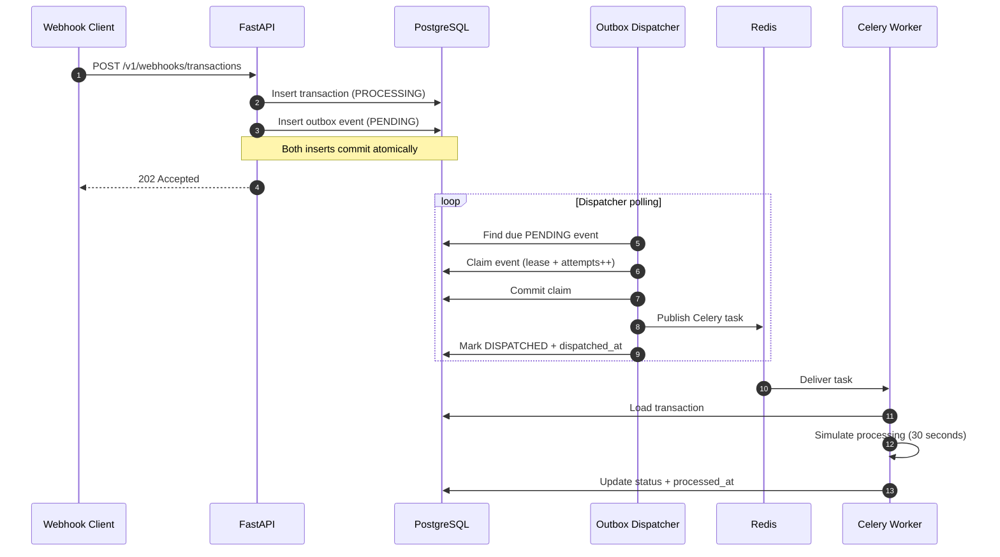
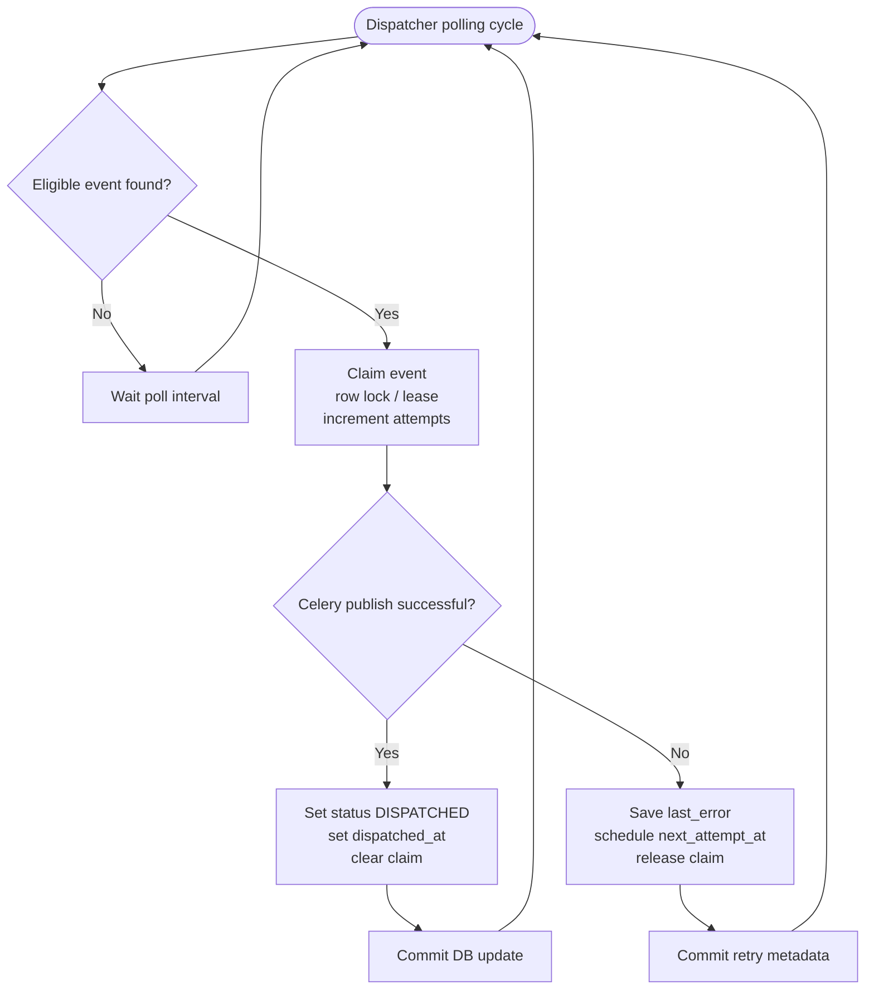
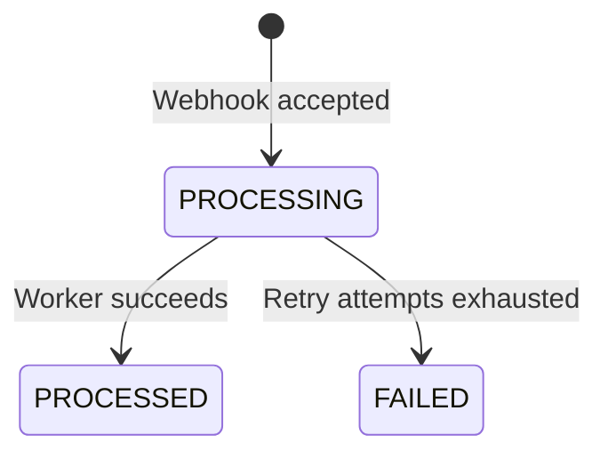
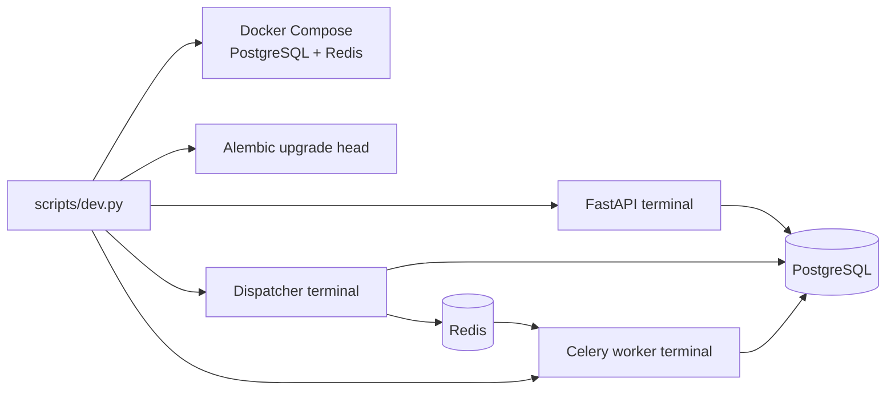

## 1. High-Level Architecture



## 2. Webhook Ingestion Sequence



## 3. Outbox Dispatch and Retry Flow



## 4. Transaction Status Lifecycle



`DISPATCHED` is an **outbox event** state, not a transaction state. It means the dispatcher published the task to Celery; it does not mean transaction processing is complete.

## 5. Responsibility by Component

| Component | Responsibility |
|---|---|
| Webhook Client | Sends transaction webhook payload |
| FastAPI | Validates payload, applies idempotency, persists transaction and outbox event, returns HTTP 202 |
| PostgreSQL | Durable source of truth for transaction and outbox records |
| Outbox Dispatcher | Claims eligible events, publishes tasks, records dispatch status and schedules retries on publish errors |
| Redis | Celery task broker |
| Celery Worker | Processes transaction asynchronously and persists the final status/timestamp |
| Alembic | Applies database schema migrations |
| Pytest | Runs live end-to-end and recovery tests |

## 6. Reliability Notes

- **Idempotency:** the unique transaction ID prevents duplicate transaction records. The outbox event also has a uniqueness constraint on `(transaction_id, event_type)`.
- **Atomic persistence:** transaction and outbox event are inserted in the same database transaction, preventing an accepted transaction from being stored without its durable event.
- **Claiming:** the dispatcher uses a database row lock with `SKIP LOCKED` and a time-limited claim lease to coordinate dispatch attempts.
- **Dispatch retry:** publish errors record `last_error`, schedule `next_attempt_at`, and release the claim.
- **Worker retry:** transient processing errors request a Celery retry; retry exhaustion is covered by the recovery tests.
- **Processing delay:** the worker intentionally waits 30 seconds to model asynchronous processing for this assignment.

## 7. Local Development Processes

Run from the project root after activating `.venv`:

```cmd
python scripts\dev.py
```

The runner starts Docker Compose services, applies Alembic migrations, and launches separate Windows terminals for the API, dispatcher, and worker.



> **Implementation note:** diagrams document the currently described implementation. Keep them synchronized with the code if component names, retry behavior, or deployment topology change.
"""